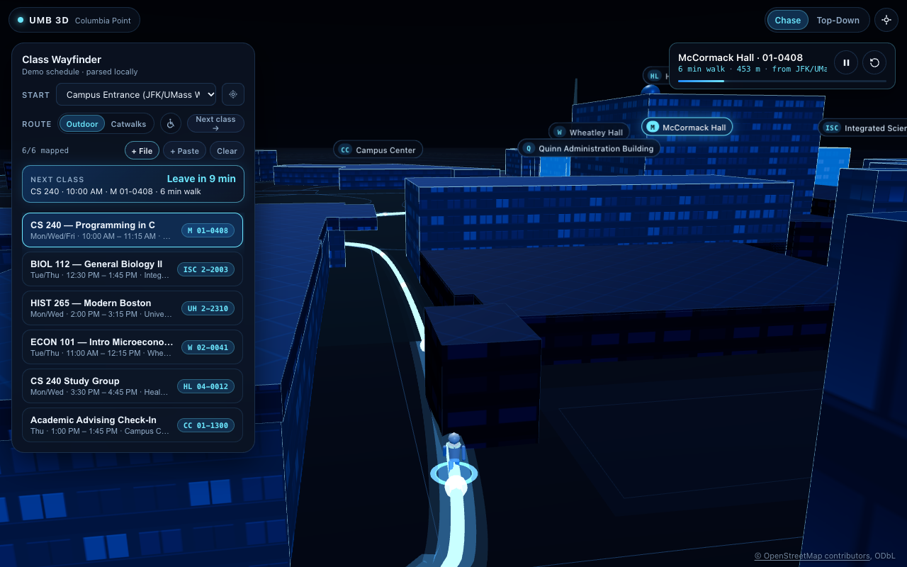
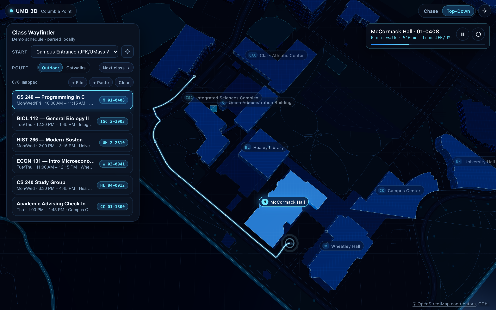

# UMB Campus 3D

A phone-first 3D **UMass Boston (Columbia Point, Dorchester MA)** campus wayfinding PWA built with TypeScript, Vite, and Three.js.

Load your class schedule (`.ics`, `.pdf`, or pasted text) or tap **Try demo schedule** to see a dark, FSD-style 3D campus with extruded OpenStreetMap buildings, glowing edges, labeled UMB landmarks, an A* footway route rendered as a glowing blue tube, and a walking avatar tracked by a smooth chase camera (with a top-down toggle).

**Live App:** [https://sdefendre.github.io/umb-campus-3d/](https://sdefendre.github.io/umb-campus-3d/)



<p align="center">
  
  
</p>

## Features (Milestone 1)

- **Dark FSD-Style 3D Campus:** Extruded building footprints from OpenStreetMap (with height / `building:levels` and building-specific fallbacks), luminous wireframe edges, dual-scale ground grid, subtle footway network, and clickable rooftop labels for all 8 major UMass Boston buildings.
- **100% Client-Side Schedule Parsing:**
  - `.ics` calendar exports via `ical.js`
  - `.pdf` schedule exports via `pdfjs-dist` (bundled local worker — no CDN calls)
  - Pasted plain text (e.g., WISER schedules or syllabus lines)
  - Bundled `demo-schedule.ics` with one-tap **Try demo schedule**
- **A* Footway Routing & Animated Avatar:** Shortest walkable route over the static OSM footway graph from selectable start points (JFK/UMass Walkway on Mt. Vernon St, Campus Center Shuttle Drop-off, or West Garage) to the destination building's nearest walkway node, with a glowing electric-blue route tube, flowing light pulses, an articulated walking avatar, **Chase** and **Top-Down** camera modes, and play/pause/replay controls.
- **Phone-First Installable PWA:** Designed for `390x844` mobile viewports with `viewport-fit=cover`, `env(safe-area-inset-*)` padding, web app manifest, icons, and an offline-capable service worker, scaling cleanly to desktop screens.

## Privacy

- **Schedules never leave your device.** All `.ics`, `.pdf`, and pasted text parsing runs exclusively in your browser.
- **No backend, no cookies, no `localStorage`, no analytics.** Schedule state exists only in memory for the current tab session.
- **Zero runtime map API calls.** OpenStreetMap campus geometry is fetched once at build/authoring time and served as a static GeoJSON file (`public/data/umb-campus.geojson`).

## Building Alias Table

Room and location strings are matched client-side to UMass Boston buildings:

| Building | Short Code | Recognized Names & Room Prefixes |
| --- | --- | --- |
| Healey Library | `HL` | `Healey Library`, `Healey`, `Joseph P. Healey Library`, `Library`, `HL`, `ULIB`, `L-…` |
| Wheatley Hall | `W` | `Wheatley Hall`, `Wheatley`, `WH`, `W-…` |
| McCormack Hall | `M` | `McCormack Hall`, `McCormack`, `Mc Cormack`, `MCC`, `MC`, `M-…` |
| University Hall | `UH` | `University Hall`, `Univ Hall`, `UHall`, `U-Hall`, `U Hall`, `UH`, `U-…` |
| Integrated Sciences Complex | `ISC` | `Integrated Sciences Complex`, `Integrated Science Complex`, `Integrated Sciences`, `Sciences Complex`, `ISC` |
| Campus Center | `CC` | `Campus Center`, `Campus Ctr`, `Student Center`, `CC` |
| Quinn Administration Building | `Q` | `Quinn Administration Building`, `Quinn Administration`, `Quinn Admin`, `Quinn`, `QA`, `QAB`, `Q-…` |
| Clark Athletic Center | `CAC` | `Clark Athletic Center`, `Clark Athletic`, `Clark Center`, `Athletic Center`, `Beacon Fitness`, `CAC`, `Gym` |

## Local Development

```bash
npm install
npm run dev
```

### Scripts

- `npm run dev` — Start Vite dev server
- `npm run typecheck` — Run `tsc --noEmit`
- `npm run build` — Typecheck and build static production bundle into `dist/`
- `npm run preview` — Preview the production build locally
- `npm run fetch-osm` — Regenerate `public/data/umb-campus.geojson` from OpenStreetMap via the Overpass API

## Data Attribution & License

- Map & building geometry: **(c) OpenStreetMap contributors, ODbL** (fetched via OpenStreetMap API and committed statically in `public/data/umb-campus.geojson`).
- Building height reference: **City of Boston Planning Department (BPDA) 2010 LiDAR `Boston_Buildings` FeatureServer Layer 9** (public open data) and OpenStreetMap `building:levels`.
- Reference evaluation photographs (`eval/reference/photos/`): **Wikimedia Commons** (CC BY 4.0 and CC BY-SA 4.0 — **not** covered by the MIT license; see [`eval/reference/photos/ATTRIBUTION.md`](eval/reference/photos/ATTRIBUTION.md) for authors, source URLs, and downscale modifications).
- Application source code: **MIT License** — see [LICENSE](LICENSE).
