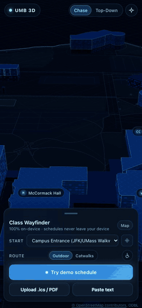
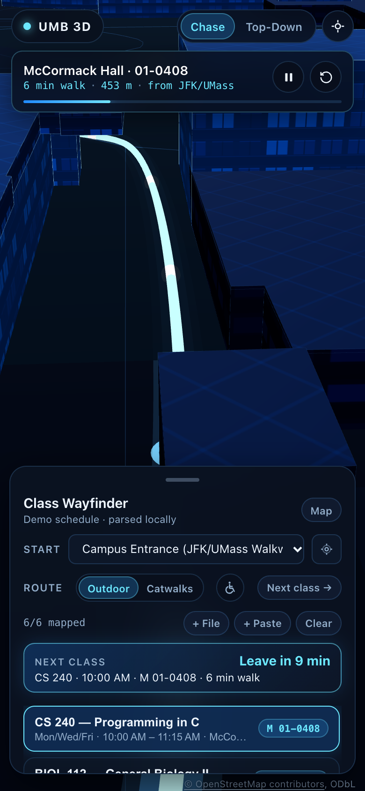
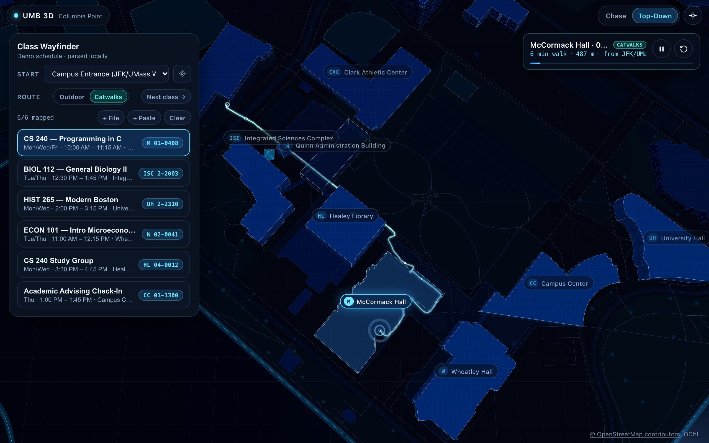
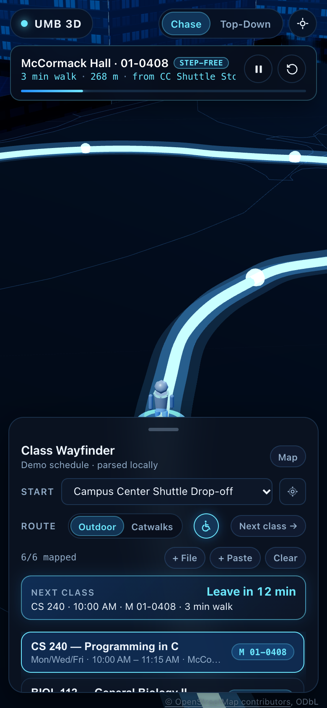

# UMB Campus 3D

A phone-first 3D **UMass Boston (Columbia Point, Dorchester MA)** campus wayfinding PWA built with TypeScript, Vite, and Three.js.

Load your class schedule (`.ics`, `.pdf`, or pasted text) or tap **Try demo schedule** to see a dark, FSD-style 3D campus with extruded OpenStreetMap buildings, glowing edges, labeled UMB landmarks, an A* footway route rendered as a glowing blue tube, and a walking avatar tracked by a smooth chase camera (with a top-down toggle).

**Live App:** [https://sdefendre.github.io/umb-campus-3d/](https://sdefendre.github.io/umb-campus-3d/)

<p align="center">
  
</p>


<p align="center">
  
  
  
  
</p>

## Features

- **Dark FSD-Style 3D Campus (M2 Realism):**
  - Extruded OpenStreetMap building footprints enriched with **City of Boston (BPDA) LiDAR** heights and **LoD2 stepped roof tiers/penthouses** (`Boston_Building_Roofprints`), plus Healey Library's rooftop observatory dome and ISC's faceted glass atrium.
  - Zero-network procedural world-scale architectural facade textures (glass curtain-wall vs. masonry ribbon windows aligned to real story heights) and rooftop grids.
  - True **Columbia Point peninsula landmass** surrounded by **Dorchester Bay** water, glowing Harborwalk shoreline, campus lawns, Monan Park athletic fields & courts, paved road ribbons, instanced low-poly campus trees, and an atmospheric cobalt horizon sky dome.
- **100% Client-Side Schedule Parsing:**
  - `.ics` calendar exports via `ical.js` (including multi-date non-RRULE weekday merging)
  - `.pdf` schedule exports via `pdfjs-dist` (bundled local worker — no CDN calls), supporting both list/table exports and multi-column WISER weekly calendar-grid PDFs
  - Pasted plain text (e.g., WISER schedules or syllabus lines)
  - Bundled `demo-schedule.ics` with one-tap **Try demo schedule**
- **Outdoor + Catwalk Routing, Live GPS & Class-to-Class Chaining:**
  - Strict outdoor A* routing by default, plus an **Outdoor / Catwalks** toggle for UMB's sheltered skybridges/corridors with elevated teal route rendering and automatic X-ray transparency on traversed buildings.
  - Selectable campus entrances, **My Location (GPS)** (100% on-device with campus-bounds validation), and **Class-to-Class chaining** (`Previous class (auto-chain)` + `Next class →` stepping).
  - Animated low-poly walking avatar, **Chase** and **Top-Down** camera modes, and play/pause/replay controls.
- **Door-to-Door Routes & Next-Class Countdown (M3):**
  - Routes end at a real building door. The app uses the 61 OSM `entrance=*` nodes on campus, matches each to the building outline it sits on, and picks the nearest reachable door. It falls back to the nearest footway when OSM maps no usable door (Clark Athletic Center today, and Wheatley/Healey in Outdoor mode because their doors open onto the plaza podium deck).
  - A **Next class** card finds your next in-person meeting from the schedule's days and times. It shows **Leave in N min** using the walk time from your chosen start or live GPS, and it updates every 30 s. Loading a schedule opens the route to that class. Tap the card to route to it again.
- **Step-Free Routing:** the wheelchair toggle next to Outdoor/Catwalks avoids the 23 mapped stair ways (`highway=steps`) and the 11 mapped raised kerbs or `wheelchair=no` points. It skips doors tagged `wheelchair=no` and uses `wheelchair=yes` doors when a building has one (today that's Healey's elevator entrance). Step-free routing only knows what OSM maps. Untagged curbs, broken elevators and slopes are invisible to it, so treat it as guidance, not a guarantee.
- **Phone-First Installable PWA:** Designed for `390x844` mobile viewports with `viewport-fit=cover`, `env(safe-area-inset-*)` padding, web app manifest, icons, and an offline-capable service worker, scaling cleanly to desktop screens.

## How It Works

1. **Campus data, fetched once.** `scripts/fetch-osm.mjs` downloads the campus bounding box from the OpenStreetMap API (buildings, footways, doors, kerbs, coastline, lawns) and joins in City of Boston LiDAR roof heights. It writes one static file, `public/data/umb-campus.geojson`, which is committed to the repo. The app never calls a map API at runtime.
2. **Lat/lon to meters.** A local tangent-plane projection (`src/geo.ts`) turns coordinates into meters around a campus origin. Across a 2 km campus the error is under 10 cm.
3. **Walking graph.** OSM footways become a weighted graph (`src/graph.ts`). Segments that cross a building footprint are marked sheltered, which is how the Outdoor and Catwalks modes differ. Stairs and raised kerbs are flagged for step-free mode.
4. **Door-to-door A\*.** Each OSM door is attached to the building outline it sits on. A route runs A\* to every usable door and keeps the shortest. When a building has no reachable door, the route ends at the footway closest to the building's center instead.
5. **Schedules stay in the tab.** `.ics` files go through `ical.js`, PDFs through a bundled `pdfjs-dist` worker, and pasted text through regular expressions. An alias table maps room codes like `M-01-0408` or `ISC 2-2003` to buildings. Days and start times drive the **Next class** countdown (`src/nextClass.ts`).
6. **Rendering.** three.js extrudes the footprints with procedural canvas facades and edge outlines, draws the route as layered glowing tubes, and moves a low-poly avatar along it with a damped chase camera.
7. **Checked on every change.** `npm run eval` loads the built app in headless Chrome. It uploads `.ics`, `.pdf` and pasted fixtures containing sentinel strings, then fails if any request leaves the origin or any sentinel appears in storage. It also scores parsing, route correctness against an independent Dijkstra, phone FPS, Lighthouse and bundle size.

## Privacy

- **Schedules never leave your device.** All `.ics`, `.pdf`, and pasted text parsing runs exclusively in your browser.
- **No backend, no cookies, no `localStorage`, no analytics.** Schedule state exists only in memory for the current tab session.
- **Zero runtime map API calls.** OpenStreetMap campus geometry is fetched once at build/authoring time and served as a static GeoJSON file (`public/data/umb-campus.geojson`).

## Building Alias Table

Room and location strings are matched client-side to UMass Boston buildings:

| Building | Short Code | Recognized Names & Room Prefixes |
| --- | --- | --- |
| Healey Library | `HL` | `Healey Library`, `Healey`, `Joseph P. Healey Library`, `Library`, `HL`, `ULIB`, `L-…` |
| Wheatley Hall | `W` | `Wheatley Hall`, `Wheatley`, `WH`, `W-…` |
| McCormack Hall | `M` | `McCormack Hall`, `McCormack`, `Mc Cormack`, `MCC`, `MC`, `M-…` |
| University Hall | `UH` | `University Hall`, `Univ Hall`, `UHall`, `U-Hall`, `U Hall`, `UH`, `U-…` |
| Integrated Sciences Complex | `ISC` | `Integrated Sciences Complex`, `Integrated Science Complex`, `Integrated Sciences`, `Sciences Complex`, `ISC` |
| Campus Center | `CC` | `Campus Center`, `Campus Ctr`, `Student Center`, `CC` |
| Quinn Administration Building | `Q` | `Quinn Administration Building`, `Quinn Administration`, `Quinn Admin`, `Quinn`, `QA`, `QAB`, `Q-…` |
| Clark Athletic Center | `CAC` | `Clark Athletic Center`, `Clark Athletic`, `Clark Center`, `Athletic Center`, `Beacon Fitness`, `CAC`, `Gym` |

## Local Development

```bash
npm install
npm run dev
```

### Scripts

- `npm run dev` — Start Vite dev server
- `npm run typecheck` — Run `tsc --noEmit`
- `npm run build` — Typecheck and build static production bundle into `dist/`
- `npm run preview` — Preview the production build locally
- `npm test` — Run the Vitest unit tests (including route checks on the committed campus data)
- `npm run eval` — Full scored evaluation with the privacy audit (needs Google Chrome installed locally)
- `npm run fetch-osm` — Regenerate `public/data/umb-campus.geojson` from the OpenStreetMap API and City of Boston open data

## Data Attribution & License

- Map & building geometry: **(c) OpenStreetMap contributors, ODbL** (fetched via OpenStreetMap API and committed statically in `public/data/umb-campus.geojson`).
- Building height reference: **City of Boston Planning Department (BPDA) 2010 LiDAR `Boston_Buildings` FeatureServer Layer 9** (public open data) and OpenStreetMap `building:levels`.
- Reference evaluation photographs (`eval/reference/photos/`): **Wikimedia Commons** (CC BY 4.0 and CC BY-SA 4.0 — **not** covered by the MIT license; see [`eval/reference/photos/ATTRIBUTION.md`](eval/reference/photos/ATTRIBUTION.md) for authors, source URLs, and downscale modifications).
- Application source code: **MIT License** — see [LICENSE](LICENSE).
